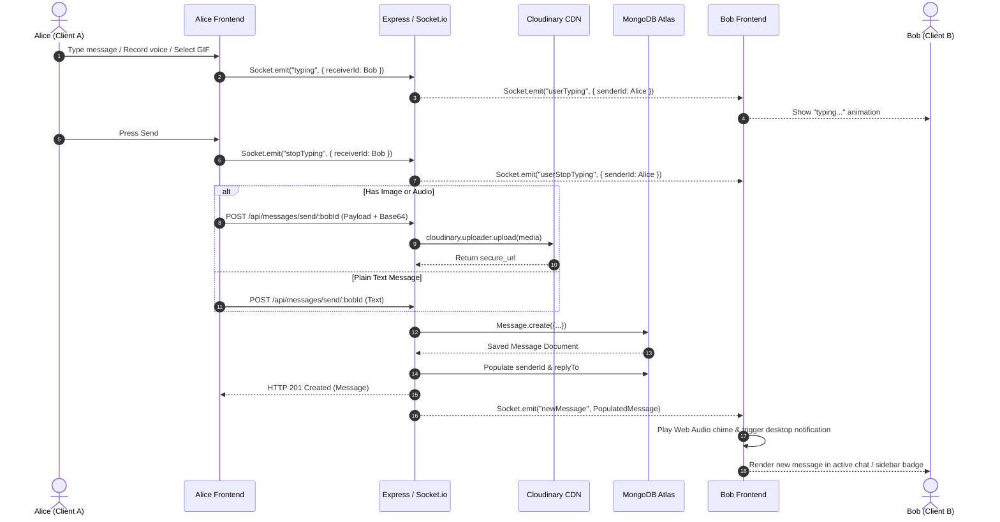
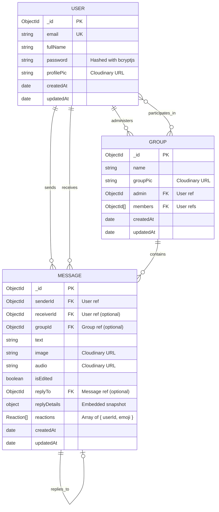

# 💬 BubbleTalk — Full-Stack Real-Time Messaging Platform

<div align="center">


[](https://react.dev/)
[](https://vitejs.dev/)
[](https://nodejs.org/)
[](https://expressjs.com/)
[](https://socket.io/)
[](https://www.mongodb.com/)
[](https://tailwindcss.com/)
[](https://daisyui.com/)
[](https://cloudinary.com/)
[](LICENSE)

**BubbleTalk** is a high-performance, real-time messaging web application built with the modern **MERN stack** (MongoDB, Express, React 19, Node.js) and **Socket.io**. It delivers an interactive messaging experience featuring 1-on-1 private messaging, group chats, live audio recording, GIPHY & WhatsApp-style sticker integration, mobile swipe-to-reply gestures, message reactions, message editing/deletion, live presence tracking, sound alerts, and 32 customizable themes.

[🚀 Live Demo](https://bubble-talk-chat-app-pjda.vercel.app) • [📡 API Server](https://bubbletalk-chat-app.onrender.com) • [🐙 GitHub Repository](https://github.com/shravanithool17/BubbleTalk-Chat-App)

</div>

---

## 🌟 Key Features

### ⚡ Real-Time Communication
- **Instant Messaging**: Low-latency, bidirectional message delivery powered by **Socket.io**.
- **1-on-1 & Group Chats**: Seamlessly switch between private direct conversations and multi-user group spaces.
- **Group Management**: Create custom groups, assign group avatars, and add multiple contacts instantly.
- **Live Online Presence**: Dynamic online/offline status tracking with multi-tab socket synchronization per user.
- **Real-Time Typing Indicators**: Live indicator displaying when the other participant is drafting a message.

### 🎙️ Rich Media & Audio Sharing
- **Voice Notes Recording**: Native browser voice recording with HTML5 `MediaRecorder` API, real-time timer, wave visualizer, instant playback preview, and cloud storage via Cloudinary.
- **Optimized Image Sharing**: Client-side canvas image compression (down to ~82% quality / 1200px max bounds) prior to upload, minimizing bandwidth and latency.
- **Interactive Media Picker**:
  - **Categorized Emojis**: Hundreds of searchable emojis grouped into Popular, Feelings, Gestures, Animals, and Food.
  - **WhatsApp Sticker Packs**: Pepe, Memes, Chibi Animals, and Reaction badges.
  - **Integrated GIF Engine**: Preset reaction GIFs and live real-time GIPHY search API integration.

### 📱 Modern Chat UX & Gestures
- **Swipe-to-Reply Gesture**: Intuitive mobile touch/pointer drag-to-reply gesture with spring animation and tactile feel.
- **Quoted Threaded Replies**: Interactive reply previews linked to original messages with smooth click-to-scroll navigation.
- **Emoji Reactions**: Floating emoji reaction tray (`👍`, `❤️`, `😂`, `😮`, `😢`, `🔥`) with grouped reaction badges and real-time counter updates.
- **Message Lifecycle Controls**: In-place message editing with `(edited)` indicators and real-time deletion.
- **Audio & Desktop Notifications**: Synthesized Web Audio API chime on new messages and native HTML5 desktop browser notifications.
- **Live Contact & User Search**: Debounced search across contacts and registered users by name or email.
- **32 Curated DaisyUI Themes**: Full personalization engine with themes ranging from Light/Dark to Synthwave, Cyberpunk, Dracula, Luxury, Sunset, and Retro.

---

## 🏗️ System Architecture

### 1. High-Level Architecture Overview

```mermaid
graph TD
    subgraph Client["Frontend Client (React 19 + Vite)"]
        UI[User Interface & DaisyUI Components]
        ZustandAuth[useAuthStore]
        ZustandChat[useChatStore]
        ZustandTheme[useThemeStore]
        AxiosClient[Axios HTTP Client]
        SocketClient[Socket.io Client]
    end

    subgraph CDN["External Cloud Services"]
        Cloudinary[Cloudinary Media Storage\n(Images & Voice Notes)]
        GiphyAPI[GIPHY Public API\n(Live GIF Search)]
    end

    subgraph Server["Backend Server (Node.js + Express 5)"]
        HTTPRouter[Express HTTP Router\n(/api/auth, /api/messages, /api/groups)]
        AuthMiddleware[JWT Protection Middleware]
        Controllers[Auth, Message & Group Controllers]
        SocketServer[Socket.io Engine\n(Presence & Real-Time Broadcast)]
        SocketMap[(userSocketMap: Set of Sockets)]
    end

    subgraph Database["Database Layer"]
        MongoDB[(MongoDB Atlas\nUsers, Messages, Groups)]
    end

    UI --> ZustandAuth
    UI --> ZustandChat
    UI --> ZustandTheme
    UI --> GiphyAPI

    ZustandAuth --> AxiosClient
    ZustandChat --> AxiosClient
    ZustandAuth --> SocketClient
    ZustandChat --> SocketClient

    AxiosClient -->|HTTPS REST API| HTTPRouter
    SocketClient <===>|WSS WebSocket Events| SocketServer

    HTTPRouter --> AuthMiddleware
    AuthMiddleware --> Controllers

    Controllers -->|Upload Base64 Media| Cloudinary
    Controllers -->|CRUD Operations| MongoDB
    Controllers -->|Emit Direct / Broadcast| SocketServer

    SocketServer <--> SocketMap
```

---

### 2. Real-Time WebSocket Event Sequence

The following diagram demonstrates the lifecycle of a message, from media processing to database persistence and multi-client socket broadcast:



---

### 3. Database Entity Relationship Diagram (ERD)



---

## 💻 Tech Stack & Tooling

| Domain | Technology | Purpose |
|---|---|---|
| **Frontend Framework** | [React 19](https://react.dev/) | Component architecture, Virtual DOM, and hooks |
| **Bundler & Tooling** | [Vite 8](https://vitejs.dev/) | Lightning-fast HMR and optimized production build |
| **Styling & Design** | [Tailwind CSS 3](https://tailwindcss.com/) + [DaisyUI 4](https://daisyui.com/) | Responsive styling, component primitives, and 32 themes |
| **Global State** | [Zustand 5](https://zustand-demo.pmnd.rs/) | Lightweight, hook-based state management |
| **Real-Time Client** | [Socket.io-client 4](https://socket.io/) | WebSocket connection, event pub/sub, auto-reconnection |
| **Routing** | [React Router DOM 7](https://reactrouter.com/) | Client-side routing and protected view navigation |
| **Icons & UI FX** | [Lucide React](https://lucide.dev/) + [React Hot Toast](https://react-hot-toast.com/) | Modern vector icons and notification toasts |
| **Backend Runtime** | [Node.js](https://nodejs.org/) | Server JavaScript runtime |
| **Web Framework** | [Express 5](https://expressjs.com/) | RESTful API routes, middleware pipeline, and CORS |
| **Real-Time Server** | [Socket.io 4](https://socket.io/) | Server-side WebSocket lifecycle & multi-socket pooling |
| **Database & ODM** | [MongoDB](https://www.mongodb.com/) + [Mongoose 9](https://mongoosejs.com/) | Document database with compound schema indexing |
| **Cloud CDN & Media** | [Cloudinary SDK](https://cloudinary.com/) | Cloud storage and optimization for images and voice notes |
| **Authentication** | [JWT](https://jwt.io/) + [bcryptjs](https://github.com/dcodeIO/bcrypt.js) | Stateless auth with HTTP-only cookies and token headers |
| **Deployment** | [Vercel](https://vercel.com/) + [Render](https://render.com/) | CDN edge frontend and managed cloud backend hosting |

---

## 📡 API Reference

### 🔐 Authentication Routes (`/api/auth`)

| Method | Endpoint | Access | Description |
|---|---|---|---|
| `POST` | `/api/auth/signup` | Public | Register new user account with hashed password |
| `POST` | `/api/auth/login` | Public | Authenticate user credentials and issue JWT cookie/token |
| `POST` | `/api/auth/logout` | Public | Clear auth cookie and invalidate session |
| `GET` | `/api/auth/check` | Protected | Verify active user JWT and retrieve profile data |
| `PUT` | `/api/auth/update-profile`| Protected | Upload and update user profile avatar via Cloudinary |

### 💬 Messaging Routes (`/api/messages`)

| Method | Endpoint | Access | Description |
|---|---|---|---|
| `GET` | `/api/messages/users` | Protected | Fetch chat contacts list for active sidebar |
| `GET` | `/api/messages/search?query=` | Protected | Debounced search for users by name or email |
| `GET` | `/api/messages/:id` | Protected | Fetch all 1-on-1 messages with a specific user |
| `POST` | `/api/messages/send/:id` | Protected | Send message (text, compressed image, audio note, reply) |
| `PUT` | `/api/messages/react/:id` | Protected | Add, toggle, or remove emoji reaction on a message |
| `PUT` | `/api/messages/edit/:id` | Protected | Edit message content (author only, sets `isEdited`) |
| `DELETE` | `/api/messages/:id` | Protected | Delete a message permanently (author only) |

### 👨‍👩‍👧‍👦 Group Routes (`/api/groups`)

| Method | Endpoint | Access | Description |
|---|---|---|---|
| `POST` | `/api/groups/create` | Protected | Create a new group with custom name, avatar, and members |
| `GET` | `/api/groups` | Protected | Fetch all groups the authenticated user belongs to |
| `GET` | `/api/groups/:groupId/messages` | Protected | Retrieve all messages within a specific group |
| `POST` | `/api/groups/:groupId/send` | Protected | Send text, image, audio, or reply inside a group |

### 🩺 System Route

| Method | Endpoint | Access | Description |
|---|---|---|---|
| `GET` | `/health` | Public | Server health-check endpoint |

---

## ⚡ Socket.IO Events Matrix

| Event Name | Direction | Payload | Description |
|---|---|---|---|
| `connection` | Client ➔ Server | `{ query: { userId } }` | Client initiates connection with their User ID |
| `getOnlineUsers` | Server ➔ Client | `string[]` (User IDs) | Broadcasts active online user IDs to all clients |
| `typing` | Client ➔ Server | `{ receiverId }` | Emits typing state when user starts typing |
| `stopTyping` | Client ➔ Server | `{ receiverId }` | Emits stop-typing state when user stops typing |
| `userTyping` | Server ➔ Client | `{ senderId }` | Notifies receiver that sender is currently typing |
| `userStopTyping` | Server ➔ Client | `{ senderId }` | Notifies receiver that sender stopped typing |
| `newMessage` | Server ➔ Client | `Message` object | Delivers newly saved direct message to receiver |
| `newGroupMessage`| Server ➔ Client | `Message` object | Broadcasts newly saved group message to group members |
| `groupCreated` | Server ➔ Client | `Group` object | Notifies invited users when a new group is created |
| `messageReaction`| Server ➔ Client | `Message` object | Synchronizes updated emoji reactions across clients |
| `messageEdited` | Server ➔ Client | `Message` object | Synchronizes updated message content across clients |
| `messageDeleted`| Server ➔ Client | `messageId` (string) | Signals clients to purge deleted message from view |
| `disconnect` | Client ➔ Server | — | Removes socket from pool and updates online users |

---

## 📂 Project Structure

```plaintext
BubbleTalk-Chat-App/
├── backend/
│   ├── src/
│   │   ├── controllers/
│   │   │   ├── auth.controller.js       # Signup, login, logout, profile update
│   │   │   ├── group.controller.js      # Group creation, message retrieval, sending
│   │   │   └── message.controller.js    # 1-on-1 messages, reactions, edits, deletes, search
│   │   ├── lib/
│   │   │   ├── cloudinary.js            # Cloudinary SDK configuration
│   │   │   ├── db.js                    # MongoDB connection helper
│   │   │   ├── socket.js                # Socket.io server instance & socket pool mapping
│   │   │   └── utils.js                 # JWT cookie generation helper
│   │   ├── middleware/
│   │   │   └── auth.middleware.js       # ProtectRoute JWT authentication guard
│   │   ├── models/
│   │   │   ├── group.model.js           # Mongoose schema for group rooms
│   │   │   ├── message.model.js         # Mongoose schema for messages, replies & reactions
│   │   │   └── user.model.js            # Mongoose schema for registered users
│   │   ├── routes/
│   │   │   ├── auth.route.js            # Auth route definitions
│   │   │   ├── group.route.js           # Group chat route definitions
│   │   │   └── message.route.js         # Message route definitions
│   │   └── index.js                     # Express app setup, CORS, HTTP & Socket server
│   ├── .env.example                     # Backend environment variable template
│   └── package.json                     # Backend scripts and dependencies
│
├── frontend/
│   ├── public/                          # Static public assets (avatar, icons)
│   ├── src/
│   │   ├── assets/                      # UI static assets
│   │   ├── components/
│   │   │   ├── skeletons/               # Loading skeleton placeholders
│   │   │   ├── AuthImagePattern.jsx     # Decorative grid pattern for auth pages
│   │   │   ├── ChatContainer.jsx        # Main chat message list & auto-scroll
│   │   │   ├── ChatHeader.jsx           # Active chat user/group header & status
│   │   │   ├── CreateGroupModal.jsx     # Modal for creating group chats
│   │   │   ├── MediaPicker.jsx          # Emojis, stickers & GIPHY GIF search
│   │   │   ├── MessageInput.jsx         # Text input, image compressor & voice recorder
│   │   │   ├── Navbar.jsx               # Top navigation bar
│   │   │   ├── NoChatSelected.jsx       # Welcome placeholder screen
│   │   │   ├── Sidebar.jsx              # Search, contact list, groups & online filter
│   │   │   └── SwipeableMessageItem.jsx # Message item with swipe-to-reply & reactions
│   │   ├── constants/
│   │   │   └── index.js                 # 32 DaisyUI theme identifiers
│   │   ├── lib/
│   │   │   ├── axios.js                 # Axios instance with auth interceptor
│   │   │   └── utils.js                 # Time formatting utilities
│   │   ├── pages/
│   │   │   ├── HomePage.jsx             # Main dashboard (Sidebar + Chat)
│   │   │   ├── LoginPage.jsx            # Sign-in page
│   │   │   ├── ProfilePage.jsx          # Profile details & avatar upload
│   │   │   ├── SettingsPage.jsx         # 32-theme selector & preview
│   │   │   └── SignUpPage.jsx           # Registration page
│   │   ├── store/
│   │   │   ├── useAuthStore.js          # Zustand auth state & socket lifecycle
│   │   │   ├── useChatStore.js          # Zustand messages, groups, reactions & audio
│   │   │   └── useThemeStore.js         # Zustand theme selector & local storage sync
│   │   ├── App.jsx                      # App router & theme provider
│   │   ├── index.css                    # Tailwind CSS base imports
│   │   └── main.jsx                     # Vite React entry point
│   ├── .env.example                     # Frontend environment variable template
│   ├── tailwind.config.js               # Tailwind configuration & DaisyUI plugins
│   ├── vite.config.js                   # Vite React build configuration
│   └── package.json                     # Frontend dependencies & scripts
│
├── .gitignore
├── package.json                         # Root build scripts
└── README.md                            # Complete Project Documentation
```

---

## 🚀 Getting Started

### 1. Prerequisites
Ensure you have the following installed on your local machine:
- **Node.js** (v18.0.0 or higher)
- **npm** (v9.0.0 or higher) or **yarn** / **pnpm**
- **MongoDB Atlas** account (or local MongoDB daemon)
- **Cloudinary** account (free tier works great)

---

### 2. Clone the Repository
```bash
git clone https://github.com/shravanithool17/BubbleTalk-Chat-App.git
cd BubbleTalk-Chat-App
```

---

### 3. Backend Setup
1. Navigate to the `backend` directory:
   ```bash
   cd backend
   ```
2. Install dependencies:
   ```bash
   npm install
   ```
3. Create a `.env` file based on `.env.example`:
   ```bash
   cp .env.example .env
   ```
4. Fill in your environment variables:
   ```env
   PORT=5001
   MONGODB_URI=mongodb+srv://<username>:<password>@cluster0.mongodb.net/bubbletalk?retryWrites=true&w=majority
   JWT_SECRET=your_super_secret_jwt_key_here
   NODE_ENV=development
   CLIENT_URL=http://localhost:5173

   # Cloudinary Credentials
   CLOUDINARY_CLOUD_NAME=your_cloud_name
   CLOUDINARY_API_KEY=your_api_key
   CLOUDINARY_API_SECRET=your_api_secret
   ```
5. Start the backend development server:
   ```bash
   npm run dev
   ```
   *The backend will boot up at `http://localhost:5001`.*

---

### 4. Frontend Setup
1. Open a new terminal and navigate to the `frontend` directory:
   ```bash
   cd ../frontend
   ```
2. Install dependencies:
   ```bash
   npm install
   ```
3. Create a `.env` file based on `.env.example`:
   ```bash
   cp .env.example .env
   ```
4. Define your API base URL:
   ```env
   VITE_BACKEND_URL=http://localhost:5001
   ```
5. Start the Vite development server:
   ```bash
   npm run dev
   ```
   *The frontend will run at `http://localhost:5173`.*

---

## ⚙️ Environment Variables Reference

### Backend (`backend/.env`)

| Variable | Description | Example |
|---|---|---|
| `PORT` | Port for Express & Socket.io server | `5001` |
| `MONGODB_URI` | MongoDB Atlas connection string | `mongodb+srv://...` |
| `JWT_SECRET` | Secret key used to sign JWT tokens | `mysupersecretjwtkey` |
| `NODE_ENV` | Runtime environment (`development` / `production`) | `development` |
| `CLIENT_URL` | Allowed origin for CORS | `http://localhost:5173` |
| `CLOUDINARY_CLOUD_NAME` | Cloudinary cloud account name | `mycloud` |
| `CLOUDINARY_API_KEY` | Cloudinary API Key | `123456789012345` |
| `CLOUDINARY_API_SECRET` | Cloudinary API Secret | `AbCdEf123456789` |

### Frontend (`frontend/.env`)

| Variable | Description | Example |
|---|---|---|
| `VITE_BACKEND_URL` | Base URL pointing to the backend server | `http://localhost:5001` |

---

## 🚢 Deployment Guide

### Deploy Backend on [Render](https://render.com)
1. Create a new **Web Service** on Render and connect your GitHub repository.
2. Set Root Directory to `backend`.
3. Set Build Command: `npm install`
4. Set Start Command: `npm start`
5. Add all Environment Variables from `backend/.env.example` in Render dashboard.
6. Set `CLIENT_URL` to your production frontend URL (e.g. `https://bubble-talk-chat-app-pjda.vercel.app`).

### Deploy Frontend on [Vercel](https://vercel.com)
1. Import your GitHub repository into Vercel.
2. Set Root Directory to `frontend`.
3. Framework Preset: **Vite**.
4. Set Build Command: `npm run build`
5. Set Output Directory: `dist`
6. Add Environment Variable:
   - `VITE_BACKEND_URL`: `https://bubbletalk-chat-app.onrender.com`
7. Deploy!

---

## 🎨 Themes Showcase

BubbleTalk ships with **32 DaisyUI themes** out of the box, accessible via the in-app **Settings** page:

| Theme Categories | Available Themes |
|---|---|
| **Clean & Light** | `light`, `cupcake`, `bumblebee`, `emerald`, `corporate`, `garden`, `lofi`, `pastel`, `wireframe`, `lemonade`, `winter` |
| **Dark & Midnight** | `dark`, `synthwave`, `halloween`, `forest`, `black`, `luxury`, `dracula`, `night`, `coffee`, `dim`, `sunset` |
| **Vibrant & Expressive** | `cyberpunk`, `valentine`, `aqua`, `fantasy`, `cmyk`, `autumn`, `business`, `acid`, `nord` |

---

## 🤝 Contributing

Contributions, issues, and feature requests are welcome!
1. Fork the Project (`git checkout -b feature/AmazingFeature`)
2. Commit your Changes (`git commit -m 'Add some AmazingFeature'`)
3. Push to the Branch (`git push origin feature/AmazingFeature`)
4. Open a Pull Request

---

## 📄 License

This project is open-source and licensed under the [ISC License](LICENSE).

---

<div align="center">

Made with ❤️ by [Shravani Thool](https://github.com/shravanithool17)

⭐ Star this repository if you find it helpful!

</div>
